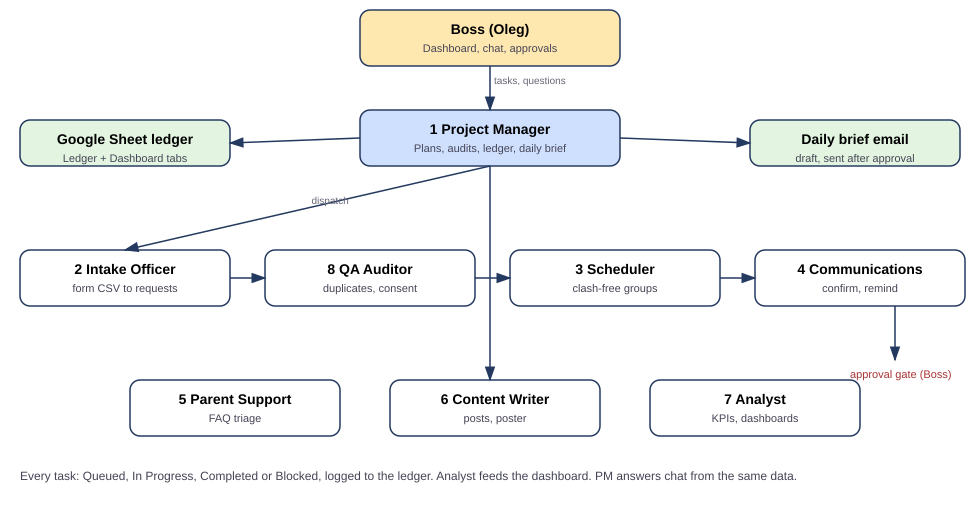

# Agency Plan: ASA Enrolment Agency (AI + Chinese)

**Type:** Education / Tutoring Operations Agency · **Client:** after-school activities (ASA), International School Premjers, Riga ·
**Programs:** AI Club (ages 7 to 15, 10 lessons) and Chinese (Beginner, HSK1, HSK2 to 3) · **Boss:** Oleg Mishchenko

**Goal:** turn one registration form into placed children, confirmed parents and live KPIs, with the teacher approving
everything that leaves the school.

| # | Employee (title) | Responsibilities | Inputs | Outputs | Tools | KPIs | Reports to / hands to |
|---|---|---|---|---|---|---|---|
| 1 | Project Manager (Chief of Staff) | Plans the day, dispatches tasks, audits the 7 employees, keeps the ledger, daily brief, answers Boss chat | Boss tasks (dashboard, chat, CLI), ledger DB | Ledger rows, daily brief email, chat answers | Google Sheets, email bridge, SQLite | Tasks done per day, blocked tasks, brief sent daily | Boss / all employees |
| 2 | Intake Officer (Applications Intake) | Reads the form export, splits "both" into an AI and a Chinese request, computes age or level band, imports registers | Form CSV, teacher registers | Enrolment requests | CSV, SQLite | New requests per day, parse errors | PM / QA Auditor |
| 3 | Scheduler (Clash-free Timetable) | Places children by program, band and availability, balances groups, never two activities on one day, keeps waitlist | Valid requests, group slots | Groups, waitlist, Schedule tab | Python, Sheets | Group fill %, waitlist, clashes avoided | PM / Communications |
| 4 | Communications Officer (Parent Emails) | Confirmation, waitlist and reminder emails per program; holds sending until approval | Groups, lesson plans | .eml and .html drafts | Email bridge (SMTP after approval) | Drafts ready, sent after approval | PM / Boss |
| 5 | Parent Support (FAQ and Triage) | Categorises parent questions, drafts FAQ replies, escalates fees, medical and unknown questions | Parent inbox, FAQ base | Triage table, draft replies | Rules, optional LLM | Answered, escalated, response time | PM / Boss |
| 6 | Content Writer (Posts and Poster) | Weekly lesson posts for both programs on 4 channels, poster copy, posts on request | Lesson plans, Boss requests | Post drafts | Templates, optional LLM | Posts per day, approved posts | PM / Boss |
| 7 | Analyst (Dashboards and KPIs) | KPIs split by program, dashboard data, Sheets exports, bottleneck flags | All tables | KPI JSON, CSV tabs, charts | pandas, Plotly, Sheets | Dashboard freshness | PM |
| 8 | QA Auditor (Data Quality and Consent) | Duplicates, consent, email format, age 7 to 15, availability, Chinese level | New requests | Valid / Needs fix / Duplicate | Python rules | Issues found, % passing QA | PM / Scheduler |

**Ledger (Google Sheet, tab Ledger):** Task ID | Timestamp | Assigned By | Agent Name | Task Description | Priority |
Status (Queued / In Progress / Blocked / Completed) | Output / Result Link | Completion Time.

**Daily brief:** tasks completed, in progress and blocked (with reason), agency KPIs per program, KPIs per employee.

**Guardrails:** demo uses synthetic sample data only; no email or post leaves without the Boss's approval; agents never
invent facts (unknown answers are escalated); credentials live in environment variables, never in the repository.
